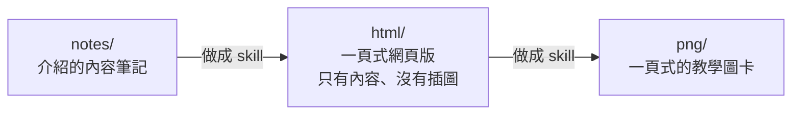

# 第 12 講｜為什麼聊天機器人也會畫圖？多模態 AI 與創作工作流

> 課程：【TAICA_生成式AI：文字與圖像生成的原理與實務】（115 學年度上學期）
> 資料來源：投影片《12 為什麼聊天機器人也會畫圖？》（26 頁）＋ 上課錄影 <https://www.youtube.com/live/2EQ5cZBtO2E>（2026-11-24 直播，約 2 小時 50 分，正式上課＋作業示範＋助教時間）
> 說明：本講義依投影片架構整理，並補上老師上課的口頭解說（標示為 💬 老師補充）。

---

## 本講重點總覽

| 單元 | 主題 | 一句話重點 |
|---|---|---|
| 01 | LLM 開始生圖？ | ChatGPT、Gemini、Claude 等聊天機器人直接就能生圖、改風格、固定角色，不必再另外用 Diffusion 模型 |
| 01 | Tokenizer 與 BPE | 語言模型看到的是一串 token 編號；中文大致一字一 token，英文常用 BPE 切成字根片段 |
| 01 | Early Fusion | 把圖像也切成一塊塊、每塊給一個 token，讓圖像變成語言模型的「另一種語言」 |
| 01 | VQ-VAE／VQ-GAN | 圖像的 tokenizer：每一小塊的 latent vector 只能從 K 個固定向量裡選一個，於是一張圖變成一串編號；VQ-GAN 再用鑑別器提升畫質 |
| 01 | 預測下一個 token 生圖 | 和文字生成一樣預測下一個圖像 token，再用 generator（decoder）把整串 token 畫成圖 |
| 02 | 作業：統一風格圖像產生的 Agent | 用一個專案（AI agent）穩定生成同一風格的圖，交至少三個同風格作品，並簡介製作流程 |
| 02 | 範例：教學圖卡 | 先想清楚流程：notes（內容筆記）→ html（只有內容）→ png（真的畫出來的圖卡），中間做成 skill |
| 💬 | 示範 | 在 Gemini「任務」開專案資料夾、讓 AI 訪問我們、生成 AGENTS.md、試做三種風格再選定、寫成專案專用 skill |
| 💬 | 助教時間 | 三場閃電秀（樂譜辨識、模型取名冷知識、物理 AI 助教）＋ 實體講座、期末專案評分、期末發表報名 |

**最重要的觀念**：聊天機器人會畫圖，是因為它把**圖像的世界看成一種語言**。圖像先被 VQ-VAE 這類 tokenizer 切成一塊塊，每塊對應到有限個「圖像單字」中的一個編號；語言模型學會這種語言後，看圖就像「把圖翻譯成中文」，生圖就像「把中文翻譯成圖像語言」——一樣是預測下一個 token，最後再交給 generator 畫出來。至於作業，重點是**教 AI 我們做事的方法**：用專案、AGENTS.md 和 skill 把流程固定下來，生出來的圖才會穩定、風格才會統一。

---

## 💬 開場說明（影片約 0:00 起）

- 上週介紹的是 Diffusion Model 的**原理**；但現在大部分情境其實不是直接用 Diffusion Model 生圖，而是用 ChatGPT、Claude、Gemini 這些聊天機器人。
- 大家都會用（打指令進去，它就把圖生出來），今天要介紹的是**語言模型到底為什麼生得出圖**。
- 「終於要開始有生圖創作的時刻了」——今天的作業開始要生圖，但是**用語言模型生圖**。
- 和上週一樣碰到電腦教室的技術困難，這週有經驗了，馬上改用另外的方法直播。

---

## 01. LLM 開始生圖？

### 1.1 ChatGPT 開始跨足到圖像生成（P3）

- 範例：「請把我的照片轉成吉卜力風格 Studio Ghibli 畫出來」。

💬 老師補充（影片約 0:01 起）：
- 生圖的歷史：最早是 GAN，後來人人開始生圖時用的是 Diffusion Model，例如 Midjourney、Stable Diffusion；後來大家漸漸發現**語言模型也可以生圖**。
- 有一陣子出現「**吉卜力之亂**」：只要跟 ChatGPT 說把這張照片畫成吉卜力風，它就會畫——用正常的語言文字就能生圖，**不用再另外用 Stable Diffusion 或 Midjourney**。

### 1.2 精確的描述（P4）

- 範例 prompt：「出一張相片：把 Nikon F4 做成小模型的樣子，有一個人手的特寫，放在她手心上的樣子。」（附一張 Nikon F4 的參考照片）

💬 老師補充（影片約 0:03 起）：
- 可以說得很仔細，也可以很簡單地給**參考圖**，人、東西都可以。
- Stable Diffusion 剛出來時，**把人畫對**是相當困難的事；現在在大型語言模型裡給一張參考圖就做得到。「又回到我們出一張嘴，它就會把我們希望的東西呈現出來。」

### 1.3 可以指定漫畫角色（P5）

- 範例：用呆萌型 AI 機器人 DIVE 當主角，畫出介紹 RAG 的英文漫畫。

💬 老師補充（影片約 0:04 起）：
- 今天的作業跟這個有一點點相關。
- 剛開始時英文生得比較好，中文字會變成「不知道哪一個星球的字」；現在比較放心讓它生成中文字了（「放心也不一定完全放心」）。

### 1.4 3D 卡通化（P6）

- 範例 prompt：「請把我們的吉祥物 "DIVE" 呆萌 AI 機器人也用同樣的風格，3D 卡通化。」

💬 老師補充：老師的說法是換成「皮克斯風格、比較 3D 的那種」呆萌型 AI 機器人。

### 1.5 當然也可以請 AI 做角色設定圖（P7）

- 做好角色設定，方便日後固定角色生成圖片及影片。

💬 老師補充（影片約 0:05 起）：
- 以後不管要拍影片或生更多圖，把**角色設定圖**（各個角度的角色圖）給它，它就知道這個角色長這樣。
- 剛開始生圖時，固定角色要用各種高級手法才做得到；現在只要做好角色圖就可以了。

### 1.6 LLM 的原理（P8）

- 輸入「炎龍老師很」→ embedding layer → transformer → 預測下一個字「幽」（169445 號）；把「幽」接回去，再預測下一個字「默」（53323 號）。
- 圖上的編號（93340、156565、176152、18730…）就是每個字對應的 token 編號。

💬 老師補充（影片約 0:05 起）：
- 回顧：語言模型就是**預測下一個字**。看完前面的字、經過 Transformer，產生一堆向量，再轉成每個字的機率（softmax 之後加起來是 1），照這個機率分布抽一個字出來。
- 這次用的是某個真正的 tokenizer，所以號碼都很大——因為要產生的字很多。

### 1.7 Tokenizer（P9）

- 「我想學習生成式 AI」→ tokenizer →〔7522, 18165, 53881, 113487, 70033, 10348, 20837〕
- **Tokenizer 就是把文字換成一系列的編號。**

💬 老師補充（影片約 0:07 起）：
- 呆萌型 AI 機器人看到的其實是這些號碼；號碼再經過 embedding 層變成比較有意義、但抽象的向量（「拿出來我們也不知道它在想什麼」）。
- 每個語言模型的 tokenizer（切字的方法）不一定一樣。中文原則上一個字一個字切，但訓練過程中為了方便，會把一些常用詞變成一個 token（例如「生成」），比較不會誤會——不然「我想學習生」，下一個不一定是「成」。

### 1.8 各代 ChatGPT 其實也不一樣（P10）

- 可以到 <https://platform.openai.com/tokenizer> 試試不同世代 ChatGPT 的 tokenizer。

💬 老師補充：每一代的切法不一樣，每一家語言模型的切法當然也不一樣；有興趣可以去「欣賞一下它是怎麼切的」。

### 1.9 BPE — 英文常見的切法（P11）

- 一個字元一個字元切，會讓序列太長；一個詞一個詞切，token 數又會太多。
- **BPE（Byte Pair Encoding）**：例如 unbelievable 會切成 un／believ／able 三個 token。

💬 老師補充（影片約 0:10 起）：
- 英文單字有過去式、現在式、加 s 等太多變化，如果每個變化都給一個 token 就太多了，所以用特定的規則去切。
- 細節「不是這麼的關鍵」，真的想知道就去問 ChatGPT 或你最信任的語言模型。

### 1.10 Early Fusion：把圖像當成一種「語言」（P12）

- 圖像 token 和文字 token 一起經過 embedding layer，送進同一個 transformer。

💬 老師補充（影片約 0:11 起）：
- ChatGPT 出現一陣子之後，第一個大進展是**它可以看圖了**：沒有投影片原始檔，截一張圖給它看；出國照一張菜單，問它上面寫什麼、幫忙翻譯。
- 為什麼能看圖？基本上就是**把一張圖變成一種語言**：把照片一塊一塊切下來，每一塊給一個 token。圖的寬度固定，所以每一列的 token 數一樣，像很工整的七言絕句。
- 懂了這個語言之後，看圖就像翻譯：「請把這張照片翻譯成中文」——它就告訴我們照片的意思、裡面的文字是什麼。
- 如果訓練得夠好，模型**不但聽得懂、也會說**這種圖像世界的語言——說出來就是生圖。

### 💬 1.11 圖像 token 不是一對一的對應（影片約 0:15 起）

- 文字世界的 token 非常固定：某個編號永遠代表 un、某個編號永遠代表「我」。
- 圖像世界不是這樣一對一。例如「客廳沙發上有一隻可愛的狗」，照片版和漫畫版的意思、配置幾乎一模一樣，只是風格不同；如果連風格都要另外設計 token，token 會多到沒辦法做。
- 所以圖像 token 會**看前後文**：同樣是 9487 號 token，每次畫出來的樣子不一定一樣。
- 「出去外面騙人的時候，就要把老師剛剛講的話再跟人家講一次」——不管是用語言模型辨識圖，還是用大型模型生成圖，都是**把圖像的世界看成一種文字**。

### 1.12 圖像的 tokenizer 怎麼做呢？（P13）

- 一個方式是用 **VQ-VAE**。

### 1.13 VQ-VAE 是一種 VAE（廢話）（P14）

- 圖 → encoder → latent vector → decoder → 圖（和上週的 VAE 一樣是 Autoencoder 的架構）。

💬 老師補充：「這個我自己聽了都覺得很慚愧。」

### 1.14 不同的是 latent vector 只有有限個選擇（P15）

- latent vector 只能等於 $e_1, e_2, e_3, \dots, e_K$ 其中一個，編號 1、2、3……K。
- **Latent vector 只有固定選擇。**

💬 老師補充（影片約 0:19 起）：
- 上週的 VAE 要學平均值和標準差，同一張圖進去每次出來都不一樣；VQ-VAE 的每一塊只能對應到 K 個向量中的一個。
- **K 是我們自己決定的**：覺得圖像世界的「單字」應該有 2 萬個，就是 1 到 2 萬；覺得太多，就 1 到 1024。
- 這 K 個向量（codebook）是在訓練過程中固定下來的，而且一樣是「我們看不懂的那種抽象向量」。

### 1.15 VQ-VAE：一塊塊找 latent vector（P16）

- 把圖切成一塊塊（圖上示意 3×3），每塊經過 encoder 對應到一個編號，例如 37、5、76、12、4、11、94、87、13。
- **於是一張圖就會變成一系列的編號。**

💬 老師補充（影片約 0:18 起）：
- 實際上不會切這麼粗，會切得更細；3×3 只是方便理解，所以會有 9 個 latent vector。
- 左上角那塊對應到 37 號向量，它的 token 就是 37；下一塊對應到 5 號向量，token 就是 5。
- 因為是用 VAE（Autoencoder）的方式訓練，輸入的圖要變成輸出的圖，就從這裡學到圖像世界的語言應該怎麼切。
- decoder **不是直接吃這些數字**，而是吃每個編號代表的 embedding（向量）。
- 「這個是我們出去外面騙吃騙喝的時候非常重要的……你知道語言模型是怎麼生成圖的，講出來人家都會很感動。」

### 1.16 VQ-GAN：提升畫質！（P17）

- generator 畫出圖，discriminator（鑑別器）判斷品質。

💬 老師補充（影片約 0:23 起）：
- 除了 VQ-VAE，外面也常看到 VQ-GAN——「我們的 GAN 終於回來了，太激動了！」（這時現場燈剛好暗掉。）
- 用 GAN 的方式：鑑別器看生成的品質夠不夠好，不夠好就淘汰，讓畫得更精細、更漂亮。「總算沒有白費我們的 GAN，這真是感人肺腑的一刻。」

### 1.17 像文字生成一樣預測下一個 token（P18）

- 圖像 token 經過 embedding layer、transformer，一個一個預測下一個圖像 token。

### 1.18 然後把圖生出來！（P19）

- 預測出來的整串 token → generator → 圖。

💬 老師補充（影片約 0:24 起）：
- 在大型語言模型的世界裡，「生成圖像」其實就是「**翻譯成圖像**」：用中文描述一張圖，它就生成圖像世界的文字（一個個 token），找到對應的 embedding，再用 generator（VAE 的 decoder）畫出來。
- 細節上和上週的 Latent Diffusion 一樣，通常先處理縮小的圖，經過 generator 和其他運算後才變成比較大的圖。
- 記得：ChatGPT、Gemini、Claude 會生圖，就是因為它們把圖像的世界看成一種語言，經過非常非常多的學習後學會了這種語言。

### 💬 1.19 聲音、影片與開源模型（影片約 0:28 起）

- **聲音**其實也一樣。**影片**有一點點像：就是好幾張圖疊起來，要生成第一張、第二張、第三張……而且前後要有關係，所以像是把一張張圖丟進去，再預測下一張圖應該長什麼樣子。
- 生圖比一般的文字學習更複雜，所以老師知道的**開源語言模型大部分還沒有生圖能力**，只有看圖能力——就像人學語言，看得懂比較簡單，要說出來比較難，「很多語言模型只能看不能說」。
- GPT、Grok、Gemini 等都是「會說」的；但在開源的情境，特別是做影片，還是比較多用 Diffusion Model。

---

## 02. 作業：統一風格的圖像產生

### 2.1 【作業】統一風格圖像產生的 Agent（P21）

- 用一個專案，專門生成**統一風格**的海報、簡報、插畫、封面圖像、單張學習圖卡等等。
- 簡單介紹製作流程。
- 鼓勵把自己的專案放上 GitHub。
- **至少三個同一風格的作品。**

💬 老師補充（影片約 0:30 起）：
- 「特別是有設計專業的同學，今天真的是你們的時間到了。」老師說自己形容圖的詞彙很貧乏；會描述、懂風格的人還是說得比較好（雖然也可以請 AI 協助寫 prompt）。
- **為什麼要做成專案，而不是直接下 prompt？** 同一段 prompt 這次生得好好的，下次可能就不一樣；每次都附參考圖又太辛苦；換一台電腦重做，失敗率更高。所以用專案的方式，設計一個 AI agent 專門生成統一風格的圖。
- 你的 agent 可以很厲害、能切換很多風格，但**交作業只交同一種風格的三個作品**，這樣才知道你真的做成功了。
- **一定要生成圖像**：簡報也要是「畫出來的」簡報（像 NotebookLM 幫你畫的那種），不是 HTML 或 PowerPoint 檔——因為這是圖像生成的作業。
- 為什麼要介紹製作流程？因為每個人的想法不一樣，可以說明你這個專案「偉大的地方」。
- 放上 GitHub 的好處：別人覺得做得好，可以拿你的專案照著做出自己的版本，也方便分享、炫耀。

### 2.2 教學圖卡（P22）

- 三種風格範例（都是解釋 Self-Attention）：日系手帳剪貼雜誌風、手繪塗鴉筆記本風、日系四格漫畫故事風。

💬 老師補充（影片約 0:38 起）：
- 風格名稱是 Gemini 自己取的。可以先做角色設定表，讓裡面出現的主角都長一樣；也可以直接說「都要 Q 版角色」。
- 再強調一次：**選一個風格就好**，用同一個風格介紹三個不同的概念、畫三張。

### 2.3 統一風格的投影片封面（P23）

- 範例：第 09 講、第 11 講的課程投影片封面。

💬 老師補充（影片約 0:41 起）：
- 課程有一個 AI agent 專門在安排課程，做封面是它的其中一個任務；每次封面都是統一風格，只改標題、副標題，插圖依當天主題稍微改（例如 Diffusion 那講畫「從完全符合常態分布的亂數慢慢變成圖」）。
- 如果每週換一個風格，15 週就有 15 種風格，「這樣不行」。

### 2.4 【範例】教學圖卡（P24）

- 以產生單張教學圖卡為例，看怎麼產生統一風格的教材。
- **老話一句，教 AI 我們做事的方法。**

### 2.5 先想清楚我們要怎麼做！（P25）

💬 老師補充（影片約 0:43 起）：
- 不要直接下 prompt 生成，要想成 **AI agent** 的方式做，生成會比較穩定，中間也可以加很多關卡（例如檢查）。
- **先整理內容的筆記（notes，Markdown 檔）**：即使要做投影片也很推薦。最後的逐頁稿不容易改，筆記大綱比較容易看出有什麼、沒什麼，自己改或叫 AI 改都容易。
- **為什麼要 HTML？** 不用畫圖、很快就能生成，主要用來檢查內容和呈現方式對不對、公式有沒有寫錯；所以 HTML **只有內容、沒有插圖**。
- **為什麼最後是 PNG，不是 PDF？** PDF 可能是直接從 HTML 轉出來的，那不是我們要的；我們要它**真的畫圖**、即時畫插圖，PNG 要活潑一點。
- **skill 是什麼？**「外面學 AI 的說得一個比一個懸疑」，其實 skill 基本上就是**我會重複使用的一個技巧**。不用特別去學怎麼打造：跟 AI 討論完，直接說「把它打包成 skill」就好。

---

## 💬 作業示範：用 Gemini 做單張教學圖卡專案（影片約 0:58 起）

### 開專案資料夾

- 用 Gemini 的「**任務**」功能（Google 最近更新，想跟 ChatGPT、Claude 看齊）；沒有的話就用上次介紹的 Antigravity。有付費的話用 Claude、ChatGPT 也都可以，「現在這個世代基本上全部都可以了」。
- 新增一個資料夾（老師取名「單張教學圖卡工作坊專案」），「看你自己覺得吉祥的位置」，自己找得到就好；選了資料夾它會警告有風險，「我們就叫它做事情」。

### 先說明專案、讓 AI 訪問我們（影片約 1:02 起）

- 告訴它這個專案要產生統一風格的單頁教學圖卡，流程是：
  1. 產生要做成圖卡的筆記，存在 `notes/`
  2. 用特定風格產生單頁 HTML 教學圖卡，存在 `html/`
  3. 生成特定風格的 PNG 圖卡，存在 `png/`
- 風格先說「之後再討論」，「免得它在那邊囉囉嗦嗦」。老師說資料夾時會在後面加斜線，是學 AI 的習慣，不加它也知道。
- 再請它先跟我們討論：還有什麼要考慮的地方、有什麼想澄清的問題——「再度用到這個非常常用的：讓它訪問我們」。一開始想清楚、AGENTS.md 寫清楚，後面會進行得比較順，跟寫程式一樣。
- 老師對 AI 提問的回答：
  - **命名規範**：照它的建議，notes、html、png 用完全一致的檔名、一對一對應。
  - **參考圖**：做 HTML 時沒有參考圖、也不需要美化插圖；做 PNG 時插圖直接生成（這次連角色設定都沒給）。
  - 內容太多的部分放到「補充區」；數學式用 LaTeX。
  - HTML 和 PNG 的風格不一定要一樣，PNG 可以視覺更生動。
  - 圖卡是 **A4 直式**。
  - **執行節奏：分階段確認，不要一條龍產出**。notes 決定要教什麼、最需要確認；常常需要修改時先不要一條龍，等調教到它自己會檢查了，再讓它一條龍。
  - 之後做成**專案專用的 skill**：先限制在這個專案裡，覺得真的寫得不錯，再開放給所有專案用、甚至分享給別人。
  - 教學主題：大多在生成式 AI 相關領域。

### 生成 AGENTS.md（影片約 1:17 起）

- 很多 AI 會偷偷幫你記下專案要做什麼，但還是很推薦生成（Claude 就生成 CLAUDE.md，這邊生成 AGENTS.md）——你才確定它為這個專案知道了什麼、「員工手冊」長什麼樣子，出問題時就去改它。

### 用語音當慣老闆（影片約 1:18 起）

- 一一回答 AI 的問題打字有點累；外面很多人搭配語音輸入的 App（老師說的名稱聽起來像「TypePlus」，待確認），用說的「完完全全當慣老闆」。

### 先寫 notes：自注意力機制（影片約 1:20 起）

- 請它建議幾個有趣的主題（它提了 embedding、餘弦相似度、自注意力機制），選了**自注意力機制**，請它寫成 note：需要經典公式，用淺顯但清楚的方式解釋原理。
- 真正做的時候，**notes 才是最該花時間的地方**：甚至可以先寫一個小 loop，讓它收集資料、選材、打草稿、自己檢查 notes 寫得怎麼樣，改到滿意再往下做。今天重點是生圖，所以直接接受它寫的內容。
- 平常會用純文字編輯器或 Obsidian 這類筆記軟體打開來改。

### HTML 版：試做三種風格（影片約 1:26 起）

- 網頁不需要美化的插圖，但可以用 CSS、JavaScript 等做說明用的圖表；請它**至少試做三種截然不同的 A4 排版風格**讓我們選。
- 有設計專業的同學可以說得更清楚（配色、什麼樣的風格）；也可以貼一個你覺得漂亮的網頁，請它照那個風格做。三種都不滿意就再請它做。
- 它做出：瑞士網格風、日系雜貨手帳風、工程藍圖架構風。現場投票選了第 2 種（日系雜貨手帳風）。

### 寫成專案專用 skill（影片約 1:35 起）

- 請它把「日系雜貨手帳風做 HTML」寫成**本專案專用的 skill**，並在 AGENTS.md 記下做 HTML 都要用這個 skill。
- skill 其實基本上就是**一個 MD 檔**，記錄這件事要怎麼做。

### 重頭戲：生成 PNG 教學圖卡（影片約 1:37 起）

- 直接下一個指令也能生圖卡，但結果「有一點點像抽卡」；用這樣的流程，每次生得比較穩定，中間也能修改。
- 一樣請它生成三種風格，共通點：插圖用日系可愛 Q 版（Chibi，大頭型）、簡單風格（聽起來像「VCTO 風格」，待確認）；顏色是日系低飽和粉彩色；畫面淡雅活潑。
- 它就自己畫插圖了——不用給角色，因為已經指定要 Q 版角色。老師覺得第 3 種最可愛，就選它，再一樣寫成 skill；之後換另外兩個主題各畫一張，作業就完成了。
- 回家的圖卡不一定要做這麼複雜的知識型圖卡：也可以做「每次都是你當主角的畫面」，或專門把任何圖轉成你指定的風格（Q 版、水彩畫風……），重點是**每次都要固定**。

---

## 💬 助教時間（影片約 1:57 起）

- 一開始因為直播聲音設定（現場只聽得到線上同學、直播收不到聲音），閃電秀改請同學加入 StreamYard 分享畫面，耽誤了一些時間。

### 閃電秀 1：AI 在音樂領域的應用——樂譜辨識（影片約 2:09 起）

- 分享者曾當過音樂老師（學校未提及）。
- 傳統流程：紙本樂譜 → 人工彈奏（電鋼琴或真鋼琴）→ 麥克風或音源線收進電腦 → 轉成音訊；非常仰賴人力、設備，彈錯或功力不同都會讓錯誤率很高。
- 介紹開源軟體 **Audiveris**（光學樂譜辨識）：用了神經網路、樣板比對、影像形態學等技術；匯入樂譜後按 transcribe，大約 30 秒就辨識完，可以匯出到 MuseScore 等軟體播放、改編。
- 不同顏色標出高音譜記號、升降記號、音符；有問題、需要人工處理的地方用紅框標起來，可以用滑鼠刪掉多餘辨識、從選單拖入正確符號。
- 信心分數：只看這顆音符的「內在分數」（例：0.73）、參照前後音符和樂理的「情境分數」（例：0.96），以及神經網路的候選排名——很像之前數字辨識作業看信心程度。
- 優點：免費、省去演奏與錄音設備、工整的電子樂譜辨識度高；限制：手寫譜、拍照歪掉的譜、多聲部複雜音型，人工校正成本較高。
- 結語：AI 是人機協作，把大量抄錄、錄製的時間還給音樂本身。

### 閃電秀 2：大模型取名的冷知識（影片約 2:21 起）

- 分享者就讀政大。主題是三家公司的模型命名邏輯（部分有查證、部分是個人猜測，「不正經的研究」）：
  - **OpenAI**：以星體命名，從小到大是 Luna（月亮）、Terra（地球）、Sol（太陽）、Astra（星辰）。
  - **Anthropic**：以文學創作命名：Haiku（俳句，最短的詩體）、Sonnet（十四行詩，在固定框架內兼顧品質與效率）、Opus（作品），以及更強的 Fable、Mythos；還有傳聞中的 Saga（北歐英雄家族史詩，未證實）。
  - **Google Gemini 4**：以化學元素命名：氫（最小最快）、氖和氬（惰性氣體，穩定、不容易幻覺）、碳（重組能力強，處理最複雜的任務）。
- 取名原因的猜測：OpenAI 想做到「宇宙級」能力；Anthropic 重視安全與倫理，文學會傳達人生道理，共同創辦人也有文學背景；Google 也做醫療、生物研究，化學元素能組合出新物質。
- 最後分享者提出自己的命名點子：用香水濃度（古龍水、淡香水、淡香精、濃香精）對應模型大小，並問大家會怎麼命名。

### 閃電秀 3：台大普通物理的 AI 助教（影片約 2:34 起）

- 分享者來自台大，介紹普通物理課的 AI 專題：一套 AI 物理助教系統（名稱待確認）。
- 問題：學生亂套公式、不理解公式的適用條件，遇到變化題就卡住。
- 用 OpenAI 的 API 加上 system prompt，**引導學生思考而不是直接給答案**：先找出學生的困難點和迷思、建立清楚的物理圖像、給幾個公式選項讓學生選並說明為什麼其他的不行、最後要學生自己檢查答案（例如用單位確認合不合理）。
- 四種模式：Problem Solving Coach（解題引導）、Concept Exploration（概念探索，會給反例、說明公式適用與不適用的情境）、General QA（一般問答，直接給答案）、Review Zone（選章節講義出題，答完後分析錯在哪裡）。系統已連結老師上課講義，學生不用自己上傳 PDF。
- 目前全班 100 多位學生中有 65 位在使用，到上週累積快 2000 筆提問；學習成效還在進行中、尚無具體數據。

### 宣布事項（影片約 2:42 起）

- **12/1（二）實體講座**：邀請一家 AI 公司的創辦人到電腦教室分享 **FDE**（AI 部署工程師）的實際經驗（公司與講者名稱聽不清，待確認）。名額 52 位，要掃 QR Code 報名；**報名且實際出席總分加 1 分，報名卻缺席會扣分**。報名資訊之後也會放 NTU COOL。
- **期末專案評分**（總分 10 分）：
  | 項目 | 比重 | 看什麼 |
  |---|---|---|
  | 專案完整度 | 35% | 功能是否完整呈現、能不能從頭操作到尾 |
  | 創意與實用性 | 35% | 是否有創新想法、能否解決真正的問題 |
  | 專案反思說明 | 30% | 用影片說明設計動機、開發中遇到的問題與解決方法，並實際 demo |
- **反思影片**：1～3 分鐘，上傳到 YouTube，連結放在書面報告**第一頁**；設公開沒問題，設不公開要給可存取的連結。簡報之後會上傳 NTU COOL。
- **期末發表（12/22）**：在 Gather Town 上做線上展示，也有其他學校的同學一起參展；在攤位前播 demo 影片或提供網站讓人互動、回答提問。
  - 自願報名會優先進入審查，**11/30（一）前**掃 QR Code 報名；12/8 公布入選名單；入選者 12/14 前上傳展示內容。
  - 上台（入選並實際參與）發表**總分加 5 分**；「如果前面作業分數沒有如你預期，歡迎一定要報名」，線上發表對比較害羞的同學也是好機會。
- **加分機制回顧**：實體講座出席 +1、期末展演 +5、做過閃電秀 +2；接下來還有兩次正課，可以把握機會報名閃電秀。

---

## 名詞對照表

| 名詞 | 說明 |
|---|---|
| 多模態 AI（Multimodal AI） | 能同時處理文字、圖像、聲音等不同形式資料的 AI；聊天機器人能看圖、生圖就是多模態 |
| Token | 語言模型處理的最小單位；每個 token 對應一個編號 |
| Tokenizer | 把文字（或圖像）換成一系列 token 編號的工具；各代、各家模型的切法不一樣 |
| BPE（Byte Pair Encoding） | 英文常用的切法，把單字切成常見片段（如 un／believ／able），避免 token 數太多或序列太長 |
| Embedding layer | 把 token 編號轉成有意義的向量的那一層 |
| Early Fusion | 一開始就把圖像 token 和文字 token 放進同一個 transformer 一起處理 |
| 圖像 token | 把圖切成一塊塊，每塊對應到的編號；同一個圖像 token 會依前後文畫出不一樣的樣子 |
| VQ-VAE（Vector Quantized VAE） | 每一小塊的 latent vector 只能從 K 個固定向量中選一個的 VAE，可當圖像的 tokenizer |
| Codebook（$e_1 \dots e_K$） | VQ-VAE 裡那 K 個固定的向量；K 是自己決定的（例如 1024 或 2 萬） |
| VQ-GAN | 在 VQ-VAE 上加 GAN 的鑑別器（discriminator），提升生成畫質 |
| Generator（生成器） | 把整串圖像 token 對應的向量畫成圖的模型（VAE 的 decoder） |
| Discriminator（鑑別器） | GAN 裡判斷生成品質夠不夠好的模型 |
| 角色設定圖 | 角色各個角度的圖，給 AI 當參考，日後生圖、生影片都能固定角色 |
| 統一風格 | 每次生成的圖都維持同一種畫風；本週作業要交至少三張同風格的作品 |
| AGENTS.md | 給 AI 的專案說明（員工手冊）；在 Claude 叫 CLAUDE.md |
| Skill | 會重複使用的做事技巧，基本上就是一個 MD 檔；可以只給這個專案用，也可以開放給所有專案 |
| 一條龍產出 | 讓 AI 從頭到尾一次做完；流程還常要修改時，建議分階段確認 |
| FDE（Forward Deployed Engineer） | AI 部署工程師，12/1 實體講座的主題 |

---

## 自我檢核

1. 現在的聊天機器人（ChatGPT、Gemini、Claude）生圖，和以前用 Stable Diffusion、Midjourney 生圖，最大的差別是什麼？
2. 「吉卜力之亂」、Nikon F4 小模型、DIVE 3D 卡通化這些例子，分別展示了語言模型生圖的哪些能力？
3. 為什麼要做角色設定圖？以前和現在要固定角色有什麼不同？
4. 什麼是 tokenizer？「我想學習生成式 AI」經過 tokenizer 會變成什麼？
5. 為什麼中文的 tokenizer 有時會把「生成」這種常用詞變成一個 token？
6. 英文為什麼不一個字元一個字元切、也不一個單字一個單字切？BPE 怎麼切 unbelievable？
7. 什麼是 Early Fusion？為什麼說「看圖」就像把圖翻譯成中文？
8. 文字 token 是一對一的對應，圖像 token 為什麼不是？
9. VQ-VAE 和上週的 VAE 最大的不同是什麼？K 是怎麼決定的？
10. 用 3×3 的例子說明 VQ-VAE 怎麼把一張圖變成一串編號。decoder 吃進去的是編號還是向量？
11. VQ-GAN 比 VQ-VAE 多了什麼？目的是什麼？
12. 語言模型生成圖像的完整流程是什麼？為什麼說在大型語言模型的世界裡，「生成圖像」其實就是「翻譯成圖像」？
13. 為什麼很多開源語言模型「只能看不能說」？做影片時目前比較常用什麼模型？
14. 本週作業要交什麼？為什麼一定要「同一種風格」的三個作品？為什麼簡報也一定要是畫出來的？
15. 為什麼老師建議用專案（AI agent）的方式生圖，而不是每次直接下同一段 prompt？
16. 教學圖卡範例的 notes → html → png 流程中，每一步各負責什麼？為什麼 HTML 不放插圖？為什麼最後是 PNG 而不是 PDF？
17. 為什麼不管做圖卡還是投影片，都建議先寫內容筆記（notes）？
18. 什麼是 skill？老師在示範中怎麼產生 skill？為什麼先做成「專案專用」？
19. 為什麼要請 AI 訪問我們、生成 AGENTS.md？什麼時候才適合讓 AI「一條龍產出」？
20. 期末專案的評分分成哪三個面向、各佔多少？反思影片有什麼規定？期末發表要在什麼時候前報名？
